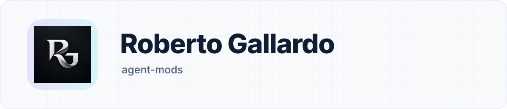

<a id="top"></a>

<!-- Generated by readme-builder; edit the JSON/content source. -->

<p align="center"><picture><source media="(prefers-color-scheme: dark)" srcset="assets/readme-builder/es/hero-dark.svg" /></picture></p>

<p align="center"><strong>Tu sesión, a la vista.</strong></p>

<p align="center"><a href="#start"><picture><source media="(prefers-color-scheme: dark)" srcset="assets/readme-builder/kit/btn-entiende-tu-sesion-outline-sm-dark.svg" /></picture></a>&nbsp;
<a href="#catalog"><picture><source media="(prefers-color-scheme: dark)" srcset="assets/readme-builder/kit/btn-elige-tus-mods-outline-sm-dark.svg" /></picture></a>&nbsp;
<a href="#install"><picture><source media="(prefers-color-scheme: dark)" srcset="assets/readme-builder/kit/btn-instala-solo-lo-que-necesitas-outline-sm-dark.svg" /></picture></a></p>

<p align="center"><a href="README.md"><picture><source media="(prefers-color-scheme: dark)" srcset="assets/readme-builder/kit/btn-english-outline-sm-dark.svg" /></picture></a>&nbsp;
<a href="README.es.md"><picture><source media="(prefers-color-scheme: dark)" srcset="assets/readme-builder/kit/btn-espanol-primary-sm-dark.svg" /></picture></a></p>

- **Choose.** Six independently installable mods.
- **Observe.** Native data. Honest limits. No model calls.
- **Understand.** Context, cost, quotas, Git and tools.

<a id="start"></a>

##  Entiende tu sesión

Elige los mods que quieras. Prueba primero uno de forma local:

```sh
git clone https://github.com/robgallardof/agent-mods.git
cd agent-mods
claude --plugin-dir ./mods/session-vitals
```

Dentro de Claude Code escribe `/vitals`. Verás contexto y coste encima del prompt. Los otros mods añaden información al indicador de trabajo y ofrecen comandos para consultarla en reposo, sin iniciar turnos del modelo.

<p align="center"></p>

<a id="catalog"></a>

##  Elige tus mods

| Mod | Command | What you see | Display |
| --- | --- | --- | --- |
| [session-vitals](mods/session-vitals) | `/vitals` | Context tokens, window fill, session cost and time since this mod loaded. | Above the prompt |
| [quota-compass](mods/quota-compass) | `/quota` | Reported account usage windows and their UTC reset timestamps. | Spinner |
| [git-lens](mods/git-lens) | `/git-lens` | Current branch and changed Git entries, including detached HEAD. | Spinner |
| [mcp-radar](mods/mcp-radar) | `/radar` | Available MCP tool names; refresh with /radar. | Spinner |
| [memory-map](mods/memory-map) | `/memory-map` | Character counts of memory sections observed after loading. | Spinner |
| [tool-pulse](mods/tool-pulse) | `/pulse` | Observed tool calls, active calls, failures and cumulative timing. | Spinner |

Cada mod se instala por separado. En terminales estrechas empieza con uno o dos: sus textos se suman al indicador de trabajo.

<p align="center"></p>

<a id="install"></a>

##  Instala solo lo que necesitas

Agrega el catálogo y selecciona los mods que necesites:

```text
/plugin marketplace add robgallardof/agent-mods
/plugin install session-vitals@agent-mods
/plugin install quota-compass@agent-mods
```

Cambia el nombre por otro del catálogo. Usa `/plugin` para desactivar o desinstalar. Respeta las preguntas de confianza y alcance del anfitrión; este proyecto no modifica tu configuración global.

<p align="center"></p>

<a id="limits"></a>

##  Qué significan los datos

**Mods nativos de Claude Code.** Se distribuyen mediante plugins, pero usan funciones dentro del agente y su interfaz nativa. La API documentada requiere 2.1.287+; esta versión se comprueba en Windows con **2.1.311**. Codex y OpenCode no están implementados. DeepSeek es un modelo/proveedor, no un anfitrión compatible con estos mods.

Los datos ausentes aparecen como desconocidos. El coste no es tu factura de suscripción; la fecha de reinicio de cuota no promete tiempo disponible. Herramientas MCP disponibles no equivalen a verificar todas las conexiones. La memoria muestra secciones observadas y sus caracteres, no todos los archivos configurados. Los tiempos de herramientas pueden solaparse.

No se hacen peticiones al modelo, conteos de tokens de pago, sondeos, telemetría ni lecturas de credenciales. Solo Git Lens ejecuta un proceso: Git de lectura, sin shell y con límite de tiempo. [Compatibilidad y límites](docs/COMPATIBILITY.md).

<p align="center"></p>

<a id="develop"></a>

##  Desarrolla y comprueba

Para desarrollar necesitas Node.js 22+, Git y el CLI oficial de Claude Code. Los mods no necesitan Node.js, dependencias ni compilación para funcionar.

```sh
npm run check
npm test
npm run test:git
npm run test:install
```

Las pruebas nativas cargan la cadena real de eventos con datos explícitos del anfitrión; la prueba de Git usa un repositorio temporal real. Consulta el [estado de pruebas](docs/STATUS.md), la [investigación](docs/RESEARCH.md) y [AGENTS.md](AGENTS.md). Los commits se escriben en inglés.

La presentación usa [readme-builder](https://github.com/robgallardof/readme-builder), SVG locales y la firma RG.

<p align="center"><a href="#top"><picture><source media="(prefers-color-scheme: dark)" srcset="assets/readme-builder/kit/btn-volver-al-inicio-outline-sm-dark.svg" /></picture></a></p>

<!-- readme-builder:signature:start -->
<p align="center"><a href="https://github.com/robgallardof"><picture><source media="(prefers-color-scheme: dark)" srcset="assets/readme-builder/es/footer-dark.svg" /></picture></a></p>
<!-- readme-builder:signature:end -->
