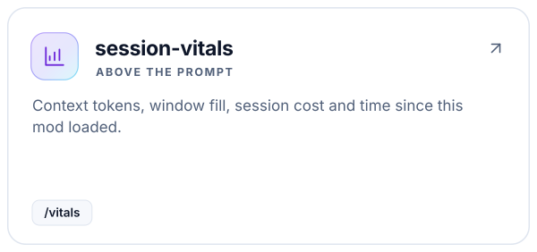
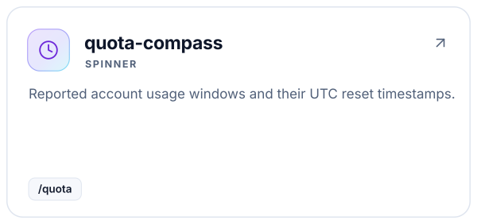
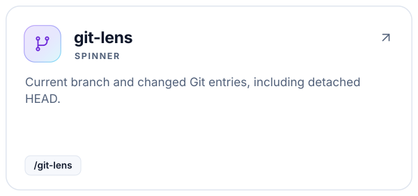
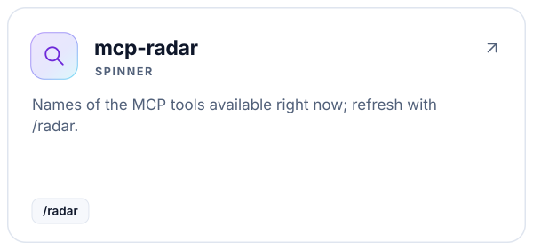
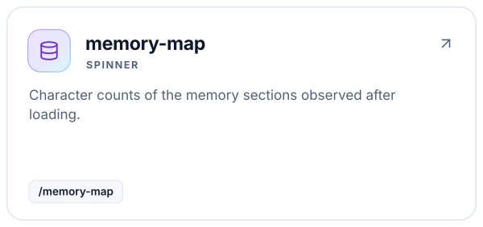
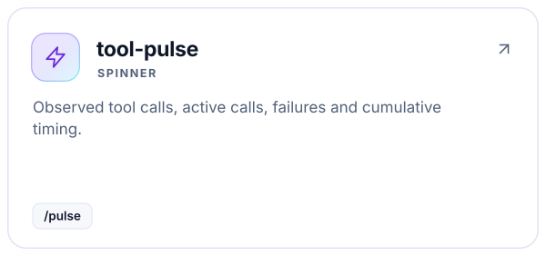

<a id="top"></a>

<!-- Generated by readme-builder; edit the JSON/content source. -->

<p align="center"><picture><source media="(prefers-color-scheme: dark)" srcset="assets/readme-builder/en/hero-dark.svg" /></picture></p>

<p align="center"><strong>Your session, in view.</strong></p>

<p align="center"><a href="#start"><picture><source media="(prefers-color-scheme: dark)" srcset="assets/readme-builder/kit/btn-see-your-session-clearly-outline-sm-dark.svg" /></picture></a>&nbsp;
<a href="#catalog"><picture><source media="(prefers-color-scheme: dark)" srcset="assets/readme-builder/kit/btn-choose-your-mods-outline-sm-dark.svg" /></picture></a>&nbsp;
<a href="#install"><picture><source media="(prefers-color-scheme: dark)" srcset="assets/readme-builder/kit/btn-install-remove-and-compatibility-outline-sm-dark.svg" /></picture></a></p>

<p align="center"><a href="README.md"><picture><source media="(prefers-color-scheme: dark)" srcset="assets/readme-builder/kit/btn-english-primary-sm-dark.svg" /></picture></a>&nbsp;
<a href="README.es.md"><picture><source media="(prefers-color-scheme: dark)" srcset="assets/readme-builder/kit/btn-espanol-outline-sm-dark.svg" /></picture></a></p>

- **Choose.** Six independently installable mods.
- **Observe.** Native data. Honest limits. No model calls.
- **Understand.** Context, cost, quotas, Git and tools.

<a id="start"></a>

##  See your session clearly

Choose one mod or combine the ones you need. First, try a local mod without installing anything:

```sh
git clone https://github.com/robgallardof/agent-mods.git
cd agent-mods
claude --plugin-dir ./mods/session-vitals
```

Type `/vitals` inside Claude Code. Context and cost also appear above the prompt. The other mods append compact information to the working spinner and offer a command you can run while idle. They do not create model turns.

<p align="center"><picture><source media="(prefers-color-scheme: dark)" srcset="assets/readme/diagrams/how-mods-work-en-dark.svg" /></picture></p>

<p align="center"></p>

<a id="catalog"></a>

##  Choose your mods

<!-- kit:catalog -->
<p align="center"><a href="mods/session-vitals"><picture><source media="(prefers-color-scheme: dark)" srcset="assets/readme-builder/kit/catalog-en-01-dark.svg" /></picture></a><a href="mods/quota-compass"><picture><source media="(prefers-color-scheme: dark)" srcset="assets/readme-builder/kit/catalog-en-02-dark.svg" /></picture></a><a href="mods/git-lens"><picture><source media="(prefers-color-scheme: dark)" srcset="assets/readme-builder/kit/catalog-en-03-dark.svg" /></picture></a><a href="mods/mcp-radar"><picture><source media="(prefers-color-scheme: dark)" srcset="assets/readme-builder/kit/catalog-en-04-dark.svg" /></picture></a><a href="mods/memory-map"><picture><source media="(prefers-color-scheme: dark)" srcset="assets/readme-builder/kit/catalog-en-05-dark.svg" /></picture></a><a href="mods/tool-pulse"><picture><source media="(prefers-color-scheme: dark)" srcset="assets/readme-builder/kit/catalog-en-06-dark.svg" /></picture></a></p>
<!-- /kit:catalog -->

Start with one or two spinner mods on a narrow terminal. Each preserves the existing spinner suffix; installing all of them can make that line long. All commands remain available without installing the other mods.

<p align="center"></p>

<a id="install"></a>

##  Install, remove and compatibility

Add the marketplace once, then select individual mods:

```text
/plugin marketplace add robgallardof/agent-mods
/plugin install session-vitals@agent-mods
/plugin install quota-compass@agent-mods
```

Repeat the second command with another catalog name. Use `/plugin` to disable or remove a mod. Follow the host's trust and scope prompts. This repository never edits user-wide agent settings for you.

| Host | Status |
| --- | --- |
| Claude Code 2.1.311, Windows | Native validation, event contract tests and command probes run |
| Claude Code 2.1.311, Linux | Native validation, event contract tests and real Git integration pass in CI |
| Claude Code 2.1.287+ | Documented API baseline; versions older than 2.1.311 not run |
| Claude Code desktop / VS Code | Depends on the component; live paint not checked |
| Codex, OpenCode | No adapter: do not install these mods there |
| DeepSeek | A model provider does not supply the Claude Code mods runtime |

<!-- kit:compat-links -->
<p align="center"><a href="docs/COMPATIBILITY.md"><picture><source media="(prefers-color-scheme: dark)" srcset="assets/readme-builder/kit/compat-links-en-01-dark.svg" /></picture></a>&nbsp;
<a href="docs/STATUS.md"><picture><source media="(prefers-color-scheme: dark)" srcset="assets/readme-builder/kit/compat-links-en-02-dark.svg" /></picture></a></p>
<!-- /kit:compat-links -->

<p align="center"></p>

<a id="limits"></a>

##  Know what the numbers mean

**Native Claude Code mods.** Anthropic distributes them through the plugin system, but their implementation uses in-process function hooks and native UI. These packages are not MCP servers or shell statusline scripts.

Claude Code 2.1.287+ is the documented API baseline. This release is validated on Windows with Claude Code **2.1.311**. Native contract tests do not paint the real terminal. Codex and OpenCode compatibility is **not implemented**; DeepSeek is a model/provider, not a compatible native mods host.

Costs come from the host ledger and do not represent your subscription invoice. Quotas may be absent and their reset time is not a work-time guarantee. MCP tool availability does not certify every server's transport health. Memory counts describe observed prompt sections, not every configured file or stored memory. Tool timings can overlap.

No model requests, paid token-count requests, background polling, analytics, or secret/configuration reads. Only Git Lens starts a process: a bounded, read-only `git status` without a shell. See [compatibility and data boundaries](docs/COMPATIBILITY.md).

<p align="center"></p>

<a id="develop"></a>

##  Build and verify

Requires Node.js 22+, Git, and the official Claude Code CLI. Mods themselves need no Node.js runtime, dependencies, bundler, or build step.

```sh
npm run check
npm test
npm run test:git
npm run test:install
```

The native test harness loads the real mod event chain with explicit host fixtures. The Git integration test creates and changes a real temporary repository. [Test status](docs/STATUS.md) records what ran; [research](docs/RESEARCH.md) records community needs and existing alternatives. Read [AGENTS.md](AGENTS.md) before contributing. Commit messages are in English.

READMEs use [readme-builder](https://github.com/robgallardof/readme-builder), local SVG assets and the shared RG signature. Rebuild with `python scripts/prepare-docs.py` followed by `readme-builder build readme.json --output .`.

<p align="center"><a href="#top"><picture><source media="(prefers-color-scheme: dark)" srcset="assets/readme-builder/kit/btn-back-to-top-outline-sm-dark.svg" /></picture></a></p>

<!-- readme-builder:signature:start -->
<p align="center"><a href="https://github.com/robgallardof"><picture><source media="(prefers-color-scheme: dark)" srcset="assets/readme-builder/en/footer-dark.svg" /></picture></a></p>
<!-- readme-builder:signature:end -->
